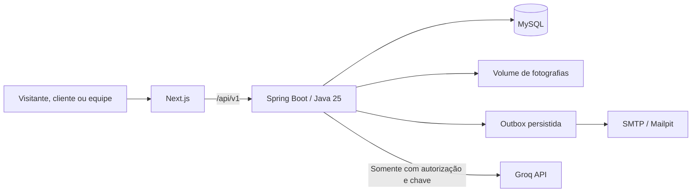

# Imobflex

Aplicação web full stack para divulgação de imóveis, atendimento a interessados e organização de visitas. O projeto foi desenvolvido como **MVP acadêmico com piloto local**, no contexto de uma imobiliária com baixa presença digital, a Talismã Imóveis.

A marca utilizada na aplicação é **Imobflex**. O catálogo de demonstração utiliza localidades reais do estado de São Paulo, fotografias ilustrativas e imóveis fictícios: os anúncios não representam ofertas comerciais reais.

## Conteúdo

- [Contexto e objetivo](#contexto-e-objetivo)
- [Funcionalidades e perfis](#funcionalidades-e-perfis)
- [Tecnologias utilizadas](#tecnologias-utilizadas)
- [Arquitetura e pastas](#arquitetura-e-pastas)
- [Chatbot e Groq](#chatbot-e-groq)
- [Executar com Docker](#executar-com-docker)
- [Desenvolvimento sem Docker](#desenvolvimento-sem-docker)
- [Configurações](#configurações)
- [Segurança e privacidade](#segurança-e-privacidade)
- [Testes e qualidade](#testes-e-qualidade)
- [Documentação e limites](#documentação-e-limites)

## Contexto e objetivo

O Imobflex reúne a apresentação dos imóveis e o acompanhamento do atendimento em um canal digital. A proposta atende três necessidades do projeto: facilitar a descoberta dos anúncios, registrar o interesse dos clientes e organizar a agenda dos corretores.

O visitante pode pesquisar sem criar uma conta. O cliente autenticado solicita visitas e acompanha notificações; a equipe gerencia anúncios, contatos e agendamentos em painéis com permissões próprias. Os indicadores apresentados são operacionais e não comprovam aumento de vendas ou conversão comercial.

## Funcionalidades e perfis

### Experiência pública

- Home com busca, atalhos por tipo de imóvel e por cidade.
- Catálogo de venda e locação, filtros combináveis, ordenação e paginação.
- Detalhes do imóvel com galeria, características, valores e contato com o corretor.
- Páginas **Sobre nós**, **Contato**, **Termos de Uso** e **Política de Privacidade**.
- Interface responsiva, menu móvel, tema claro/escuro e preferência de aparência salva.
- Setas nas páginas internas com retorno direto à home; a seta não aparece na home.
- Assistente flutuante ao lado do WhatsApp, com sugestões e orientações sobre o site.
- Foco visível, rótulos de formulário, textos alternativos e respeito à preferência por movimento reduzido.

### Contas e permissões

| Perfil | Recursos disponíveis |
| --- | --- |
| Visitante | Consultar catálogo, detalhes, páginas institucionais, contato público e assistente |
| Cliente | Solicitar e acompanhar visitas, consultar notificações e gerenciar sua conta e privacidade |
| Corretor | Gerenciar imóveis e atendimentos atribuídos, configurar disponibilidade, confirmar visitas e registrar seus resultados |
| Administrador | Gerenciar a operação, equipe, imóveis, publicação, auditoria, indicadores e solicitações de privacidade |
| Proprietário | Cadastro e vínculo com imóveis; não possui portal próprio no MVP |

No login, a escolha **Cliente**, **Corretor** ou **Admin** é validada contra o perfil da conta. Selecionar uma opção não concede permissões. O autocadastro cria clientes; a administração cadastra os demais participantes autorizados.

### Imóveis, visitas e atendimento

- Proprietário e corretor vinculados ao imóvel; preços de venda e aluguel separados.
- Fotografias JPG/PNG, capa e miniaturas; publicação exige de três a vinte imagens válidas, com limite de 5 MB por arquivo.
- Aprovação administrativa para a primeira publicação de anúncios pendentes.
- Edição por vínculo, histórico de alterações e inativação; exclusão física restrita a pendentes sem histórico.
- Agenda, disponibilidade semanal, bloqueios e calendário de feriados versionado.
- Visitas com duração de uma hora, antecedência mínima de 24 horas e prevenção de conflitos de imóvel, corretor e cliente.
- A solicitação reserva o horário e aguarda confirmação. Somente a equipe registra realização ou ausência; o tempo não conclui a visita automaticamente.
- Cancelamento pelo cliente com pelo menos 12 horas de antecedência; regras adicionais de estado são aplicadas pelo backend.
- Contatos associados ao anúncio, respostas da equipe e notificações.
- E-mails processados por fila persistida, com tentativas e registro de falhas.

## Tecnologias utilizadas

As versões abaixo são as declaradas no repositório, não uma indicação de que sejam as versões mais recentes disponíveis.

| Camada | Tecnologias | Uso no projeto |
| --- | --- | --- |
| Frontend | Next.js **16.4.6**, React **19.3.1**, JavaScript e JSX | App Router, páginas públicas renderizadas no servidor e interfaces interativas |
| Estilos | Tailwind CSS **4.3.3** e CSS | Tokens, responsividade, temas e componentes visuais |
| Fontes e ícones | DM Sans e Manrope via Fontsource **5.3.0**; Lucide React **1.56.0** | Tipografia hospedada localmente e ícones da interface |
| Runtime frontend | Node.js **24**, npm e `package-lock.json` | Instalação reproduzível e execução do Next.js |
| Backend | Java **25**, Spring Boot **4.1.1** e Maven Wrapper | API REST e regras de negócio |
| Segurança | Spring Security, BCrypt e Spring Session JDBC | Autenticação, autorização, cookies de sessão e CSRF |
| Persistência | Spring Data JPA/Hibernate e Spring JDBC/JdbcTemplate | Contas, consultas, transações e acesso ao banco |
| Banco | MySQL **8.4.9** no Compose, InnoDB e `utf8mb4` | Dados operacionais, sessões, auditoria e fila de e-mails |
| Migrações | Flyway com suporte a MySQL | Evolução versionada do esquema |
| Assistente | Regras locais, catálogo público e API Groq opcional | Orientações e geração de respostas com autorização |
| E-mail | Spring Mail e Mailpit **1.27.8** no Compose | Envio pelo backend e captura de mensagens no piloto |
| Qualidade | JUnit, Mockito, Testcontainers, Vitest, Playwright, axe-core e ESLint | Testes de regras, integração, navegador e verificações automatizadas de acessibilidade |
| Ambiente e versionamento | Docker Compose, Git, GitHub e GitHub Actions | Execução local, histórico e integração contínua |

Java 25 e Node.js 24 são as linhas escolhidas para o projeto. Tailwind não possui uma linha LTS formal. O suporte prolongado comercial do Spring não está contratado; não se deve interpretar a stack inteira como coberta por um único programa de suporte LTS.

## Arquitetura e pastas

O navegador acessa a API pela mesma origem do frontend, sob `/api/v1`. O Next.js encaminha as requisições ao Spring Boot. Somente o backend acessa o MySQL e o serviço externo de IA.



```text
IMOBFLEX_Project/
├── frontend-imobflex/       # Next.js, componentes, estilos e testes de interface
├── backend-imobflex/        # Spring Boot, regras, segurança, armazenamento e testes Java
├── sql-imobflex/
│   ├── migrations/          # Fonte única de migrações Flyway
│   └── seeds/               # Scripts auxiliares, conforme documentação da pasta
├── docs/                    # Arquitetura, requisitos, operação, análise e validação
├── .github/workflows/       # GitHub Actions
├── compose.yaml             # Frontend, backend, MySQL e Mailpit
└── .env.example             # Modelo de configuração do Compose, sem segredos reais
```

O Maven empacota as migrações de `sql-imobflex/migrations` no backend. O Hibernate valida o esquema; não cria nem atualiza tabelas automaticamente. Fotografias ficam em armazenamento local persistente, com interface preparada para uma futura implementação em armazenamento de objetos.

## Chatbot e Groq

O assistente é uma interface de orientação, **somente de leitura**. Não é necessário configurar IA para que ele funcione.

### Modo local

1. O visitante abre o chat e escolhe uma sugestão ou escreve uma pergunta.
2. O frontend envia `message` e `useAi` para `POST /api/v1/public/chat`, preservando sessão e CSRF.
3. O backend identifica assuntos como imóveis, visitas, conta, atendimento e privacidade.
4. Quando a pergunta envolve o catálogo, consulta a quantidade de imóveis na finalidade identificada.
5. Retorna uma orientação e links internos definidos pelo próprio servidor, com `mode: "LOCAL"`.

Esse modo não envia a pergunta a um provedor de IA. Ele orienta o uso dos filtros; não implementa uma busca completa por linguagem natural nem consulta documentos em um banco vetorial.

### Modo com IA opcional

A Groq é o serviço externo usado para executar o modelo de linguagem. A autorização de envio começa desmarcada no chat e é independente das escolhas de marketing e cookies opcionais.

Quando `useAi` é `true` **e** `GROQ_API_KEY` está configurada:

- O Spring Boot envia a pergunta e a orientação pública selecionada para `https://api.groq.com/openai/v1/chat/completions`.
- O modelo recebe instruções para responder em português, usar o contexto fornecido e não inventar condições nem executar ações.
- A resposta válida é identificada por `mode: "GROQ"`. Os links continuam sendo os definidos pelo backend, não pelo modelo.
- Sem chave, com serviço indisponível, resposta inválida ou limite de chamadas simultâneas atingido, o assistente utiliza a orientação local.

O modelo padrão no código é `llama-3.3-70b-versatile`, substituível por `GROQ_MODEL`. A disponibilidade do modelo e as condições de uso devem ser verificadas na conta do provedor. Referências: [documentação Groq](https://console.groq.com/docs/openai) e [modelos](https://console.groq.com/docs/models).

### Configurar a Groq

No Compose, edite o `.env` da raiz:

```dotenv
GROQ_API_KEY=<nova chave fornecida pelo provedor>
GROQ_MODEL=llama-3.3-70b-versatile
```

Recrie o serviço para aplicar a configuração:

```powershell
docker compose up -d --force-recreate backend
```

Em execução direta, defina as variáveis **no terminal do backend antes de iniciá-lo**:

```powershell
$env:GROQ_API_KEY='<nova chave fornecida pelo provedor>'
$env:GROQ_MODEL='llama-3.3-70b-versatile'
```

Nunca use `NEXT_PUBLIC_GROQ_API_KEY` nem coloque a chave em componentes, no README ou em arquivos versionados. Use uma chave própria fornecida pelo provedor, armazenada apenas no ambiente do backend.

### Limites e tratamento da conversa

| Controle | Implementação |
| --- | --- |
| Pergunta | Até 1.000 caracteres; corpo JSON de até 8 KiB |
| Frequência | Até dez perguntas por minuto por sessão e sessenta por minuto por instância |
| Chamadas externas | Até três simultâneas, timeout de requisição de oito segundos |
| Dados pessoais | Bloqueio de alguns formatos comuns de CPF, e-mail e telefone; não é um detector completo |
| Histórico | Texto da conversa em memória da página, com opção de limpeza; não é salvo no banco da aplicação |
| Apresentação | Respostas renderizadas como texto React, sem executar HTML retornado pelo modelo |
| Ações | Sem acesso a contas, agendamento, cancelamento, aprovação ou alteração de imóveis |

As perguntas autorizadas são enviadas à Groq e passam pelo tratamento do provedor. A ausência de histórico no banco da Imobflex não significa ausência de tratamento pelo serviço externo. As respostas de IA podem conter erros; informações sobre o imóvel devem ser confirmadas com a equipe. Os limites locais são por instância e não substituem controle compartilhado em uma implantação com múltiplas réplicas.

## Executar com Docker

Requisitos: Git, Docker Engine ou Docker Desktop com Docker Compose.

```powershell
git clone https://github.com/VitorPorcionato/IMOBFLEX_Project.git
cd IMOBFLEX_Project
git switch codex/imobflex-mvp
Copy-Item .env.example .env
```

Edite `.env` e substitua as senhas de exemplo por valores próprios. Defina `BOOTSTRAP_EMAIL` e `BOOTSTRAP_PASSWORD` para criar o primeiro administrador. A chave Groq é opcional. Em seguida:

```powershell
docker compose up --build -d
docker compose logs -f backend
```

Aguarde a inicialização do banco, a aplicação das migrações e a inicialização dos serviços.

| Serviço | Acesso no Compose |
| --- | --- |
| Aplicação | [localhost:3000](http://localhost:3000) |
| Caixa de e-mails do piloto | [localhost:8025](http://localhost:8025) |
| Saúde do backend pela aplicação | [localhost:3000/api/v1/health](http://localhost:3000/api/v1/health) |
| Contrato OpenAPI | [localhost:3000/api/v1/openapi](http://localhost:3000/api/v1/openapi) |
| MySQL e backend | Rede interna do Compose; sem portas próprias publicadas no host |

As portas públicas do Compose estão vinculadas ao localhost. Banco e fotografias usam volumes persistentes. Para encerrar os serviços sem apagar os volumes:

```powershell
docker compose down
```

### Catálogo de demonstração

Para uma instalação nova com dados fictícios, configure antes da inicialização:

```dotenv
SPRING_PROFILES_ACTIVE=demo
DEMO_PASSWORD=<senha forte exclusiva para as contas fictícias>
```

O fluxo completo do perfil `demo` prepara **25 exemplos**, com capas distintas, descrições próprias e localidades de São Paulo. O seed inicial cria três imóveis e contas de demonstração; uma expansão acrescenta dez; a curadoria atualiza os exemplos originais elegíveis e acrescenta outros doze. Marcadores de execução impedem repetir as expansões. Exemplos editados e registros removidos são tratados pelas condições de preservação dos seeds, portanto uma base já modificada pode ter quantidade diferente.

As contas `cliente@example.test` e `corretor@example.test` usam `DEMO_PASSWORD`. O proprietário de demonstração não possui portal. O administrador usa as credenciais configuradas em `BOOTSTRAP_EMAIL` e `BOOTSTRAP_PASSWORD`. Não há senha administrativa real publicada no README.

Os dados e as fotos de demonstração não devem ser apresentados como ofertas reais. Origens dos recursos: [ASSETS.md](docs/ASSETS.md).

### Primeiro fluxo sem dados de demonstração

1. Entre como administrador e cadastre proprietário e corretor em **Usuários**.
2. Confirme o e-mail do corretor pela caixa de testes. O proprietário não acessa um portal próprio.
3. Configure a disponibilidade do corretor; sem horários liberados, não há slots para reservar.
4. Cadastre um imóvel e envie pelo menos três fotografias válidas.
5. Publique o imóvel como administrador, alterando sua situação para **Disponível**.
6. Cadastre um cliente e confirme o e-mail pela caixa de testes.
7. Com a conta do cliente, solicite uma visita em horário livre, respeitando a antecedência.
8. Confirme como corretor e registre o resultado após o término da visita.

Contas criadas pela administração precisam registrar seu próprio aceite dos termos para as operações que o exigem. O bootstrap cria apenas o primeiro administrador; mudar sua variável de senha depois não redefine automaticamente uma conta existente.

## Desenvolvimento sem Docker

Requisitos: JDK 25, Node.js 24, MySQL 8.4 e servidor SMTP de testes, como Mailpit. O Maven Wrapper acompanha o backend.

Crie o banco `imobflex` com `utf8mb4` e um usuário dedicado, com permissões para as migrações. Os valores entre `<...>` nos exemplos devem ser substituídos. No PowerShell, a partir da raiz do repositório:

```powershell
$env:DATABASE_URL='jdbc:mysql://localhost:3306/imobflex?connectionTimeZone=UTC&forceConnectionTimeZoneToSession=true'
$env:DATABASE_USER='imobflex'
$env:DATABASE_PASSWORD='<senha do banco>'
$env:BOOTSTRAP_EMAIL='admin@example.test'
$env:BOOTSTRAP_PASSWORD='<senha forte do administrador>'
$env:MAIL_HOST='localhost'
$env:MAIL_PORT='1025'
$env:PUBLIC_URL='http://localhost:3000'
cd backend-imobflex
.\mvnw.cmd spring-boot:run
```

O Spring não carrega um arquivo `.env` automaticamente nessa execução. Exporte as variáveis no processo que inicia o backend. Para usar os exemplos, configure também `SPRING_PROFILES_ACTIVE=demo` e `DEMO_PASSWORD` antes de iniciar.

Em outro terminal, a partir da raiz:

```powershell
cd frontend-imobflex
Copy-Item .env.example .env.local
npm ci
npm run dev
```

O `.env.local` do frontend aponta `BACKEND_URL` para `http://127.0.0.1:8080`. Na execução direta, o frontend usa a porta 3000, o backend 8080 e o SMTP de testes 1025. Em Linux/macOS, use `./mvnw` e a sintaxe de variáveis do seu shell.

Para gerar e iniciar o frontend em modo de produção local, mantendo o backend em execução:

```powershell
npm run build
npm start
```

### Se o localhost não abrir

| Sintoma | Verificação |
| --- | --- |
| Nada responde na porta 3000 | Confirme que o frontend está executando ou consulte `docker compose ps` e `docker compose logs frontend` |
| Interface abre, mas catálogo não carrega | Verifique o backend, o banco e `BACKEND_URL`; no Compose o endereço interno é `http://backend:8080` |
| Backend não inicia | Confira credenciais do MySQL, JDK e mensagens das migrações no log |
| E-mail de confirmação não chega | Abra a caixa SMTP de testes; Mailpit não encaminha mensagens para destinatários reais |
| Chat responde sem IA | Confira autorização no chat, `GROQ_API_KEY`, modelo, limites do provedor e reinício do backend |
| Não existem horários de visita | Confira disponibilidade, bloqueios, feriados, antecedência e cobertura do calendário |

## Configurações

| Variável | Finalidade |
| --- | --- |
| `DATABASE_URL`, `DATABASE_USER`, `DATABASE_PASSWORD` | Conexão do backend com MySQL |
| `MYSQL_ROOT_PASSWORD` | Inicialização do MySQL no Compose; diferente da senha do usuário da aplicação |
| `BOOTSTRAP_EMAIL`, `BOOTSTRAP_PASSWORD` | Provisionamento do primeiro administrador |
| `SPRING_PROFILES_ACTIVE`, `DEMO_PASSWORD` | Ativação explícita e credenciais do ambiente de demonstração |
| `MAIL_HOST`, `MAIL_PORT`, `MAIL_USERNAME`, `MAIL_PASSWORD` | Configuração SMTP do backend; o Compose usa Mailpit |
| `PUBLIC_URL` | URL pública usada pelo backend em links e e-mails |
| `BACKEND_URL` | Endereço do Spring Boot acessível pelo Next.js |
| `NEXT_PUBLIC_SITE_URL` | URL pública informada ao frontend |
| `GROQ_API_KEY`, `GROQ_MODEL` | Configuração opcional da IA, somente no backend |
| `UPLOAD_PATH` | Diretório persistente de fotografias do backend |
| `COOKIE_SECURE` | Ativar em HTTPS para o cookie de sessão |
| `PRIVACY_ENCRYPTION_KEY` | Base64 de 32 bytes aleatórios para identidade temporária de visitas que exijam CPF |
| `PRIVACY_RETENTION_ENABLED` | Habilita a rotina geral de retenção após revisão e teste em cópia isolada |
| `WHATSAPP` / `NEXT_PUBLIC_WHATSAPP` | Configuração do contato adicional do anúncio; o botão flutuante utiliza o canal já definido no projeto |

Use os modelos da [raiz](.env.example), do [backend](backend-imobflex/.env.example) e do [frontend](frontend-imobflex/.env.example). Algumas variáveis são específicas de execução direta; para personalizar o Compose além do que ele já encaminha, ajuste também sua seção `environment`.

## Segurança e privacidade

- Senhas armazenadas com BCrypt; autorização por perfil e vínculo com o recurso.
- Sessões persistidas no MySQL, com expiração por inatividade, cookie `HttpOnly` e proteção CSRF.
- Confirmação de e-mail, recuperação de senha e bloqueio temporário após falhas de login.
- DTOs e validação no backend; a interface não determina permissões.
- Transações e bloqueios para evitar reservas concorrentes incompatíveis.
- Termos versionados e registro de aceite; marketing com escolha separada e descadastro.
- Banner com aceitar/recusar opcionais; a preferência não ativa rastreadores que não estejam implementados.
- Central de Privacidade para acesso e exclusão, inclusive com verificação de e-mail para fluxos sem conta.
- Retenção, anonimização e identidade temporária documentadas, com rotina geral sujeita à configuração operacional.
- Registro de incidentes e apoio ao acompanhamento; comunicação à ANPD e aos titulares é uma ação do responsável, não um envio automático da aplicação.

Esses recursos não constituem certificação de segurança ou garantia de conformidade jurídica. A operação com dados reais depende de controlador, canais de atendimento, políticas, infraestrutura e procedimentos definidos. Veja [PRIVACIDADE.md](docs/PRIVACIDADE.md) e [OPERACAO.md](docs/OPERACAO.md).

Não versione `.env`, chaves de API, credenciais, uploads, backups ou documentos pessoais. Backups e restauração exigem procedimentos próprios; as migrações não substituem uma cópia de segurança.

## Testes e qualidade

Backend, a partir da raiz:

```powershell
cd backend-imobflex
.\mvnw.cmd verify
```

Por padrão, a integração utiliza Testcontainers com MySQL e precisa de Docker. Sem Docker, configure `TEST_DATABASE_URL`, `TEST_DATABASE_USER` e `TEST_DATABASE_PASSWORD` para um **banco novo, vazio e dedicado a testes**. Nunca aponte essas variáveis para o banco da aplicação; as suítes alteram os dados.

Frontend, em outro terminal a partir da raiz:

```powershell
cd frontend-imobflex
npm ci
npm run lint
npm test
npm run build
npx playwright install
npm run test:e2e
```

Para executar contra uma aplicação já iniciada:

```powershell
$env:E2E_URL='http://localhost:3000'
npx playwright test tests/e2e/back-navigation.spec.js tests/e2e/chat-company.spec.js --project=chromium
```

Alguns cenários requerem backend, dados de demonstração e SMTP de testes. A configuração de Playwright inclui Chromium, Firefox, WebKit e um projeto de dispositivo móvel. O [workflow](.github/workflows/ci.yml) executa verificações de backend, frontend e fluxo integrado com Compose em eventos de push e pull request.

Os testes cobrem autenticação, permissões, visitas concorrentes, catálogo, privacidade, chatbot, navegação e layouts. As verificações com axe-core são automatizadas e não substituem revisão manual de acessibilidade. As chamadas Groq são simuladas nos testes de backend; não comprovam uma chamada real com uma chave de produção.

Os registros efetivamente executados, datas e limitações estão em [VALIDACAO.md](docs/VALIDACAO.md). A existência de um workflow não significa que toda execução remota esteja aprovada.

## Documentação e limites

| Documento | Conteúdo |
| --- | --- |
| [Arquitetura](docs/ARQUITETURA.md) | Organização da aplicação e decisões técnicas |
| [Requisitos](docs/REQUISITOS.md) | Escopo e rastreabilidade funcional |
| [Operação](docs/OPERACAO.md) | Ambiente, e-mail, backups e implantação |
| [Privacidade](docs/PRIVACIDADE.md) | Consentimento, dados, retenção e procedimentos |
| [Validação](docs/VALIDACAO.md) | Testes e evidências registradas |
| [Frontend](docs/FRONTEND-VISUAL.md) | Identidade, temas, navegação e dados de exemplo |
| [Recursos visuais](docs/ASSETS.md) | Origem de fotografias e fontes |
| [Análise da referência Talismã](docs/ANALISE-REFERENCIA-TALISMA.md) | Comparação técnica e adaptação do assistente |
| [Revisão visual](docs/DESIGN-REVIEW.md) | Apontamentos e limites do verificador de design |
| [OpenAPI](backend-imobflex/src/main/resources/openapi.yaml) | Contrato da API, servido também por `/api/v1/openapi` |
| [Banco de dados](sql-imobflex/README.md) | Migrações e orientações de execução |

Contratos, propostas formais, pagamentos, relatórios de conversão comercial, portal do proprietário, realidade aumentada e publicação automática em redes sociais não integram o MVP. A integração Groq é opcional e requer configuração própria. O verificador visual da skill possui apontamentos registrados; não há aprovação integral de design declarada.

Para implantação comercial, ainda é necessário validar hospedagem, HTTPS, SMTP real, capacidade, monitoramento, fotos autorizadas, backups, restauração e operação dos pedidos de privacidade. Ative `COOKIE_SECURE=true` quando houver HTTPS e revise o calendário antes de liberar novas datas de visita.

O versionamento utiliza Git e GitHub, com trabalho nas branches `codex/…`. A versão descrita neste README está na branch `codex/imobflex-mvp`; o envio a essa branch não equivale à incorporação automática na `main` nem à publicação em um servidor de produção.
