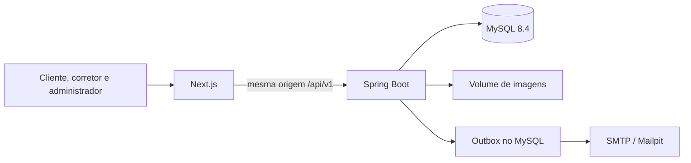
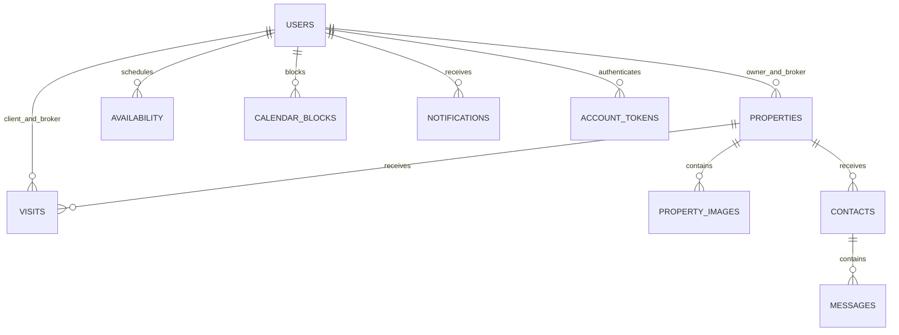

# Arquitetura e decisões

## Módulos

- AuthService/AuthController e UsersController: cadastro, confirmação, recuperação, login e perfis.
- PropertyService/Images: imóveis, transições, auditoria e fotografias. ImageStorage abstrai disco.
- VisitService/CalendarController: reservas, regras temporais e disponibilidade.
- ContactsController/MailQueue: atendimento, notificações e entrega persistida.
- Access/SecurityConfig: sessão JDBC, CSRF, perfil e vínculo. DTOs de escrita validados e projeções explícitas limitam os dados públicos.

Next encaminha a API; regras ficam no Spring. Valores monetários: strings no JSON e BigDecimal/DECIMAL no servidor. Instantes UTC e interface de Brasília. API em inglês e UI em português.

## Estados

Imóvel novo → PENDING → aprovação admin → AVAILABLE. NEGOTIATING mantém visibilidade e bloqueia novas reservas. SOLD/RENTED/INACTIVE saem do público e cancelam visitas futuras atomicamente. Retorno a AVAILABLE exige ação humana. Publicação exige três imagens. Edição durante negociação alerta administradores.

SCHEDULED reserva imediatamente; corretor confirma; após o término registra COMPLETED/NO_SHOW. Cancelamento de cliente exige 12h; nova reserva exige 24h. Slots de uma hora e janela máxima de 90 dias. Agenda começa vazia. Alterar grade não cancela reservas existentes.

CPF e endereço mantidos por decisão do solicitante. Validação de CPF não comprova identidade. Administrador inicial usa identificador interno reservado `00000000000`, rejeitado no autocadastro. Não pode ser desativado enquanto for o único administrador.

## Interface

Carmesim #9B1536, vinho #6E1028, dourado #B58A32, branco #FFFFFF, cinza #F3F4F6 e texto #242424. Source Serif 4 em títulos e Source Sans 3 na interface, servidas localmente. Fotografias em destaque; sem carrossel automático. Filtros laterais no desktop e coluna única no celular. Estados vazios e falhas são explícitos.

## Evoluções

RF11, portal do proprietário, propostas formais e automação social. Nenhum esquema de pagamentos/contratos é criado antecipadamente. Infraestrutura e política definitiva de dados precedem operação real.
